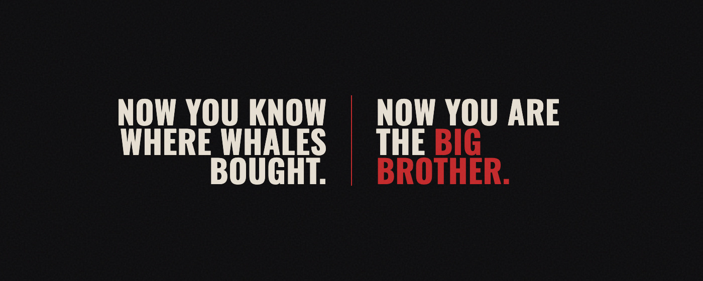

# Big Brother

[](https://chromewebstore.google.com/detail/big-brother/akjpnekipplfnoaaannagojelndapomj)
[](https://developer.chrome.com/docs/extensions/mv3/)
[](https://github.com/GMGNAI/gmgn-skills)
[](https://colosseum.org)

> Chrome extension that draws **Avg Buy MC** and **Avg Sell MC** lines for top holders and top traders, so you can see insiders entry and trade from those levels.

[Live](https://bigbrother.watch/) · [Chrome Web Store](https://chromewebstore.google.com/detail/big-brother/akjpnekipplfnoaaannagojelndapomj) · [X](https://x.com/bigbrodotwatch) · [Support](https://t.me/bigbrodotsupport)

---



---

## Submission to 2026 Solana National Hackathon

| Name | Role | Contact |
|------|------|---------|
| Big Brother | Chrome extension | [Telegram](https://t.me/bigbrodotsupport) · [X](https://x.com/bigbrodotwatch) |

---

## Problem and Solution

I trenched myself and used a similar product built into Axiom and GMGN. The lines were calculated wrong, so I built Big Brother to fix them and help trenchers trade smarter.

### 1. Holder average treated every wallet the same
- **Problem:** Holder lines were a simple average. A dust wallet counted the same as a wallet holding size.
- **Big Brother:** Holder Avg Buy and Avg Sell are balance-weighted. Each wallet is weighted by the tokens it still holds.

### 2. No way to take non-traders out of the line
- **Problem:** No blacklist, and no control to exclude CEX hot wallets, lockers, or LPs. Those addresses are not the book, and they pull the average off the real cost.
- **Big Brother:** LPs are always excluded. A local blacklist removes any wallet you add. A CEX filter drops high-transfer deposit addresses. A protocol filter drops lockers and treasuries above a supply-share cap.

### 3. Solver transfers had no cost
- **Problem:** Wallets that received supply from a solver as a transfer, not a buy on a DEX, were left out. There was no average for them.
- **Big Brother:** When there is no DEX average, the line can still price that wallet from transfer-in cost and transfer-in amount.

### 4. The line went stale
- **Problem:** No real-time updates. The level stayed put while the chart moved.
- **Big Brother:** The active tab refreshes on an interval, down to a few seconds in Fast mode, and redraws the lines.

### 5. Traders had no level
- **Problem:** No trader lines at all.
- **Big Brother:** Separate Avg Buy MC and Avg Sell MC lines for a chosen range of top traders.

---

## Summary of Features

- Avg Buy MC and Avg Sell MC lines for top holders and top traders
- Holder lines weighted by tokens still held; trader lines as a plain average
- Separate buy and sell rank ranges, from 1 to 100
- GMGN, Axiom, FOMO, Pump.fun Terminal, and Dexscreener
- Local blacklist with import and export, per chain
- Eye widget, settings, and blacklist before payment
- lines customization: colors, names, movement around current price box

---

## Tech Stack

| Layer | Technology |
|-------|-----------|
| Extension | JavaScript · Chrome Manifest V3 |
| Market data | GMGN OpenAPI |
| Pair → mint | Dexscreener API |
| Accounts / billing | Node.js · Fastify · Postgres |
| Checkout | NOWPayments (priced in SOL) |
| Site | Vite |
| Production | Docker · Caddy · Cloudflare |

This repository does not include the license server. It holds the Chrome Web Store package only.

---

## Architecture

```
┌─────────────────────┐     ┌─────────────────────┐     ┌──────────────────┐
│ GMGN · Axiom · FOMO │────▶│    Big Brother      │────▶│  GMGN OpenAPI    │
│ Pump.fun Terminal   │     │    Chrome MV3       │     │ holders, traders │
│ Dexscreener         │     └──────────┬──────────┘     │ token info       │
└─────────────────────┘                │                └──────────────────┘
                            ┌──────────▼──────────┐
                            │   Dexscreener API   │
                            │  pair / pool → mint │
                            └─────────────────────┘
```

Holder line: balance-weighted average of each wallet's average buy or sell, times circulating supply. Trader line: plain average of the wallets in range.

---

## Quick Start

This repository contains `big-brother-cws.zip` — the extension package, not the server.

1. Open https://chromewebstore.google.com/detail/big-brother/akjpnekipplfnoaaannagojelndapomj and download the extension from CWS.

---

## Roadmap

- [x] Avg Buy / Avg Sell lines on five terminals
- [x] Local blacklist, import and export
- [x] Chrome Web Store release
- [ ] Indexer per chain, so lines no longer depend on the GMGN OpenAPI
- [ ] Solana indexer first, then Robinhood Chain, Base, BSC, etc.

---

## Resources

- [Live site](https://bigbrother.watch/)
- [Chrome Web Store](https://chromewebstore.google.com/detail/big-brother/akjpnekipplfnoaaannagojelndapomj)
- [Privacy](https://license.bigbrother.watch/privacy)
- [X / Twitter](https://x.com/bigbrodotwatch)
- [Telegram support](https://t.me/bigbrodotsupport)

---

## License

All rights reserved. This repository is the store package for review, not an open-source release.
